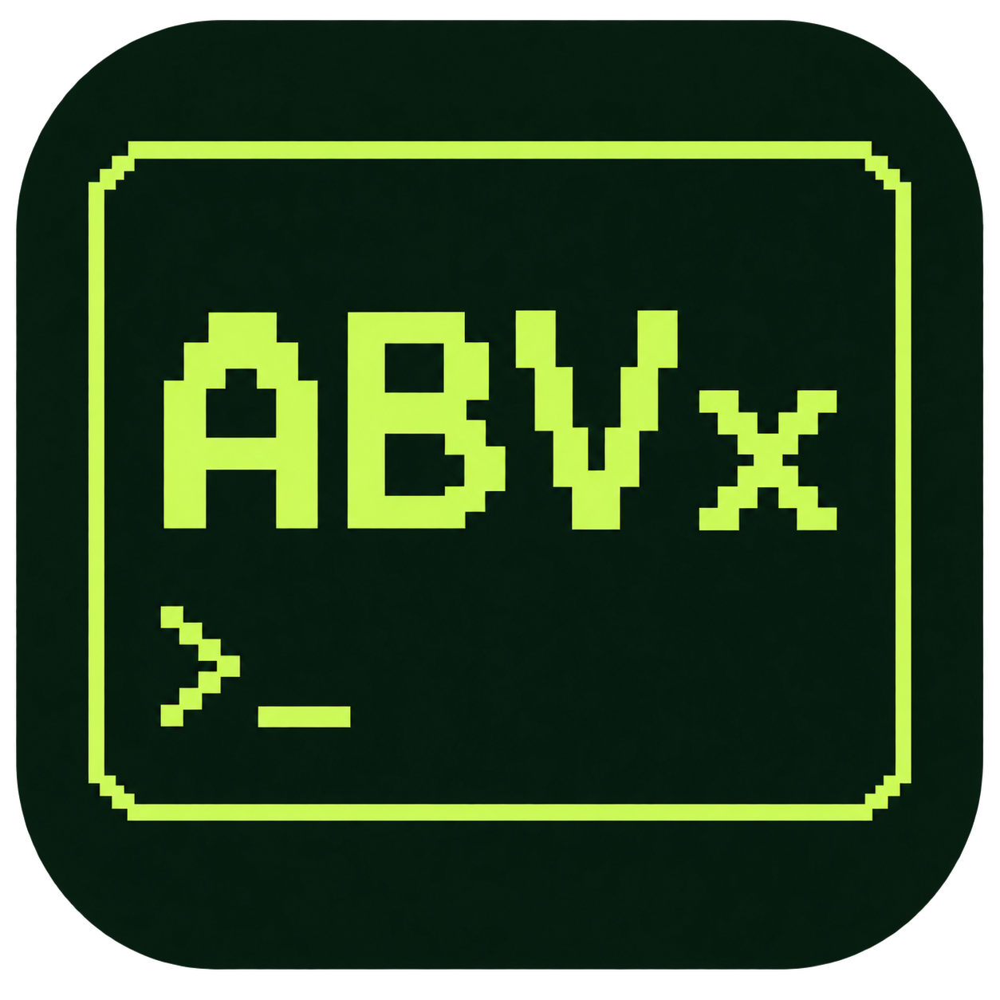
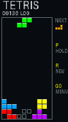
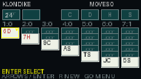
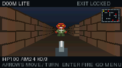

<p align="center"></p>

# Pocket OS / ABVx for Cardputer ADV

[](https://github.com/markoblogo/Pocket-OS-Cardputer-ABV/actions/workflows/checks.yml)
[](https://github.com/markoblogo/Pocket-OS-Cardputer-ABV/releases)
[](LICENSE)

**A music player, book reader, short voice recorder and three keyboard games on one pocket computer.**

Built for the **M5Stack Cardputer ADV**, its 240x135 display and 8 MB flash,
without PSRAM. Media stays on your SD; the Mac Companion prepares files and
exports internal recordings. Everyday use works without an AI service.

[Download rc3](https://github.com/markoblogo/Pocket-OS-Cardputer-ABV/releases/tag/v0.3.0-rc3) ·
[Install / upgrade](docs/INSTALL.md) · [Mac Companion](docs/COMPANION_DESKTOP.md) ·
[Games controls](docs/GAMES.md)

> **0.3.0-rc3 is a release candidate.** Software checks and hardware observations
> are tracked separately. GPS development is paused: the tested CAP responds on
> I2C but supplies no GNSS UART data. Music, Reader and Games do not require GPS.

## On the device

| App | What it does |
| --- | --- |
| Music | MP3 playback, shuffle, volume, readable titles and library navigation |
| Reader | TXT reading, speed reading and bookmarks; Companion converts EPUB/FB2/HTML |
| Voice | Short internal recordings and size/SHA-256-verified Wi-Fi export |
| Games | Portrait Tetris, draw-one Klondike with sequence moves, colour DOOM LITE |
| Notes / Inbox | Keyboard capture, local history and recovery-aware persistence |
| Time / Routines / Files | Timers, habits and access to SD content |
| Transfer | Temporary Wi-Fi AP for internal Voice, clock sync and staged uploads |
| YTMamp remote | Optional token-protected LAN controls; [YTMamp setup guide](docs/YTMAMP.md) |
| Journey | Experimental GNSS tracking; hardware work is paused |

## Games that fit the screen

Turn the device clockwise for **Tetris**: the complete 10x20 field uses 10-pixel
cells. **Klondike** supports alternating-colour runs, stock recycling and scrolling
through long columns. **DOOM LITE** is an original small raycaster with coloured
walls, enemies, hit detection and an exit. It is an adaptation, not the original
DOOM engine; it needs no WAD, extra firmware or SD assets.

<p>



</p>

These are software-rendered fixtures from the game drawing code, with approximate
host font metrics. They are **not device photographs**. Controls and hardware
checks are in [Games](docs/GAMES.md).

## Get started

1. Read [backup and installation](docs/INSTALL.md). Upgrade without `erase_flash`.
2. Download the three firmware binaries and `SHA256SUMS.txt` from the release.
   This build targets **ADV only**, not the original Cardputer.
3. Prepare a **FAT32** SD using the local pipeline or Mac Companion.
4. Follow the [smoke checklist](docs/SMOKE_TEST.md) before relying on a new build.

For a source build, use **ESP-IDF 5.4.4**:

```sh
. "$HOME/esp/esp-idf-v5.4.4/export.sh"
idf.py build
sh tools/check_host.sh
```

## Mac Companion

```sh
zsh tools/install_companion_app.zsh
```

Open **Applications > ABVx Companion**. Choose a task after connecting the relevant
transport. The native window uses a compact, high-contrast terminal interface.
It requires Python 3 and Apple's command-line tools (`xcrun`/`swiftc`) for the
local app build; firmware builds also require ESP-IDF and the
checkout. The app is locally signed, not Apple-notarized. Existing installations
are preserved; the installer accepts a different destination.

| Connection | Purpose |
| --- | --- |
| USB | Firmware programming; the SD does not appear as a USB drive |
| SD card reader | Music, books and external note backup |
| Transfer Wi-Fi | Internal Voice export and device time |

Open Transfer on Cardputer and join the Wi-Fi network using the displayed
password. Bluetooth file transfer is not implemented. [Companion instructions](docs/COMPANION_DESKTOP.md).

## Your files

- MP3 duplicates are identified by content; titles have readable ASCII fallbacks.
- Payloads are verified before publishing the new index; previous payloads remain
  hidden for recovery. Sync does not automatically prune that recovery folder.
- Invalid music sources stop a normal sync before replacing a good library.
- Voice export checks size and SHA-256 and retains device originals.
- A mount failure does not automatically format non-empty Voice storage.

Keep backups: SD electrical faults, card removal and power loss still need
physical testing. [Data safety](docs/DATA_SAFETY.md).

## Optional AI

Local transcription and experimental intent routing run on the Mac. Model
weights are installed separately. There is no autonomous on-device LLM in this
release. [Voice to text](docs/VOICE_TO_TEXT.md).

## Project and contributions

[Status](docs/PROJECT_STATUS.md) · [Roadmap](docs/ROADMAP.md) ·
[Release audit](docs/AUDIT_2026-10-22.md) · [Hardware evidence](docs/HARDWARE_ACCEPTANCE.md) ·
[Changelog](CHANGELOG.md) · [Module boundaries](docs/FIRMWARE_MODULES.md) ·
[Contributing](CONTRIBUTING.md) · [Documentation index](docs/README.md)

If you use Pocket OS, a star helps other Cardputer owners find it. Reports with
board revision, version and reproduction steps help more than a vague failure.
Do not publish private recordings, books, location tracks or Transfer passwords.

Project-owned code uses the **MIT License**. Vendored components retain their own
licenses; see [third-party notices](docs/THIRD_PARTY_NOTICES.md).

<!-- ABVX:ECOSYSTEM:BEGIN -->
## ABVX ecosystem

- [YTMamp](https://github.com/markoblogo/YTMamp/releases/latest) — Controls YTMamp through the versioned, token-protected cast API and checks the shared contract in CI. Current release: `v0.4.1`.
- [AGENTS.md_generator](https://agentsmd.abvx.xyz/) — Keeps repository guidance and machine-readable context current. Current release: `v0.5.1`.
- [abvx-agent-skills](https://abvx.xyz/work/abvx-agent-skills) — Uses shared, reviewable agent capabilities during maintenance. Current release: `v0.16.1`.

_This block is generated from the reviewed ABVX ecosystem registry._
<!-- ABVX:ECOSYSTEM:END -->
